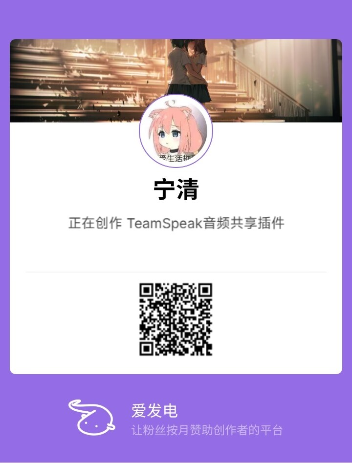

# LocalAudio

这是我为 **TeamSpeak 3** 做的一款插件，让大家在连麦时也能方便地分享音乐、使用 AI 降噪和共享屏幕。

**Design by ningq**

[下载最新版](https://github.com/NingQ197/LocalAudio-Plugin/releases/tag/v2.5.2) · [安装说明](docs/安装与卸载.md) · [源码构建](BUILDING.md)

## 选择版本

| 版本 | 包含功能 |
| --- | --- |
| **音频版** | GTCRN / RNNoise 麦克风降噪、应用音频共享 |
| **屏幕版** | 音频版全部功能，以及屏幕 / 窗口共享 |

**只安装一个版本即可。** 不需要共享画面就选音频版，需要共享画面就选屏幕版。安装包在 [Release 页面](https://github.com/NingQ197/LocalAudio-Plugin/releases/tag/v2.5.2)下载。

## 运行环境

- TeamSpeak **3.6.2，64 位**。
- Windows **10 21H2 或更新版本，64 位**，以及 Windows 11。
- 安装器会自动检查并补齐需要的微软运行库。

请先安装 TeamSpeak 客户端，再安装 LocalAudio 插件。

## 开始使用

1. 完全退出 TS，包括托盘图标。
2. 运行选中的安装包，确认 TS 目录和用户设置目录。
3. 重新打开 TS，跟随首次使用教程完成设置。

首次教程分两步：先了解 AI 降噪，再了解音频共享。以后想重新查看，可以从 **插件 → LocalAudio：使用教程…** 打开。

### AI 麦克风降噪

在 **选项 → 音频输入** 中选择 **GTCRN** 或 **RNNoise**，再调整降噪强度。它只处理麦克风，分享的音乐保持原样。建议关闭 TS 自带的背景降噪，避免重复处理。

### 音频共享

从插件菜单打开 LocalAudio，选择 **QQ 音乐、网易云音乐、Edge 或 Chrome**。找不到目标程序时，点击“扫描应用”，根据程序图标选择。

在播放器里播放音乐后，点击 **开始声音转播**，同频道成员就能听到。音乐播放音量、采样率和采样位深可以按需调整。

### 屏幕共享

屏幕版支持共享整个屏幕或指定窗口，并可设置分辨率和帧率。同频道安装了兼容插件的成员可以直接观看。

默认优先直连，需要中继时可在网络设置中配置。共享声音会排除本机 TS 的声音，减少连麦回声。

## 升级与卸载

切换版本或升级前，先退出 TS。安装器会备份旧插件，保留身份、书签和语音设置。

卸载可从 Windows 已安装的应用中进行，详细路径及回退方法见[安装说明](docs/安装与卸载.md)。

## 源码

`audio/` 和 `screen/` 分别是两个版本，`native-ui/` 是降噪设置和首次教程，`installer/` 是独立插件安装器。构建方法见 [BUILDING.md](BUILDING.md)。

感谢 RNNoise、GTCRN、Sherpa-ONNX、ONNX Runtime 等开源项目。相关第三方许可见 `third_party/` 和 `THIRD_PARTY_NOTICES.txt`。

## 爱发电

